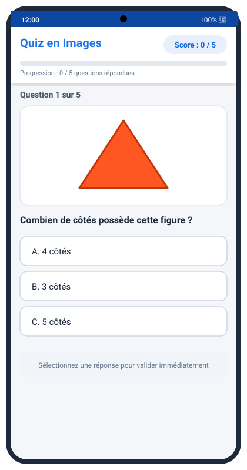
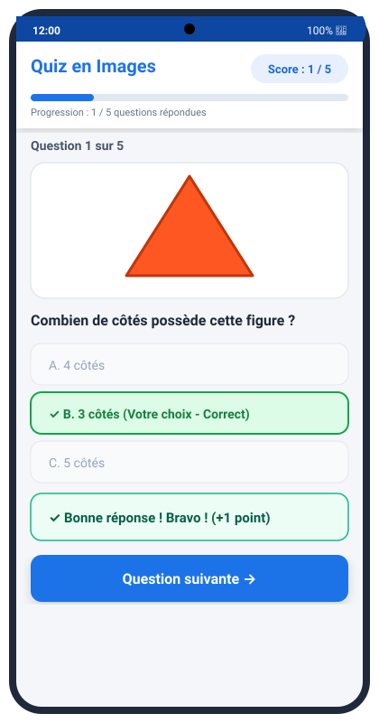
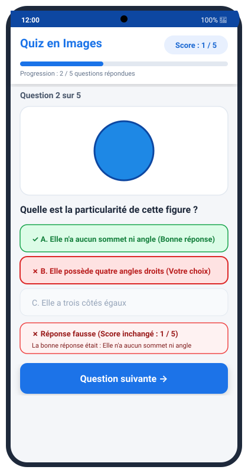
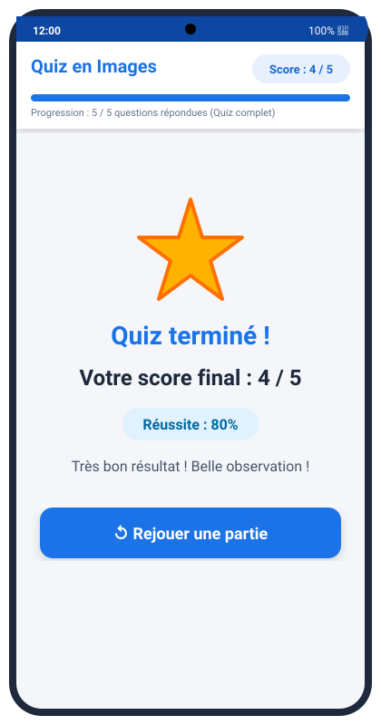

# Captures d'écran de l'application Quiz en Images

Ce dossier contient les captures d'écran illustrant le bon fonctionnement de l'application selon les exigences de l'énoncé du TP.

---

## 1. Première question au lancement
**Situation :** Lancement de l'application avec la première question, son illustration vectorielle sans déformation, ses trois boutons de choix initiaux, le score affiché à `0 / 5` en haut à droite et la barre de progression à `0 / 5`.

---

## 2. Validation d'une bonne réponse
**Situation :** L'utilisateur clique sur la bonne réponse ("3 côtés").
- Le score passe immédiatement à `1 / 5` en haut à droite.
- La barre de progression avance à `1 / 5`.
- Les trois boutons de choix sont désactivés pour éviter les clics répétés ou l'attribution de points supplémentaires.
- Le choix correct est mis en évidence en vert avec la mention `✓`.
- Un bandeau de feedback explicite apparaît (`✓ Bonne réponse ! Bravo !`).
- Le bouton de navigation `Question suivante →` devient visible.

---

## 3. Validation d'une mauvaise réponse
**Situation :** L'utilisateur clique sur un mauvais choix ("Elle possède 4 angles droits").
- Le score **reste inchangé** à `1 / 5`.
- La barre de progression avance tout de même à `2 / 5` (car la progression mesure le nombre de questions traitées).
- Les trois boutons sont désactivés.
- Le mauvais choix sélectionné est marqué en rouge avec `✗`.
- La bonne réponse attendue est mise en évidence en vert pour la lisibilité pédagogique.
- Un retour textuel clair s'affiche avec la correction.
- Le bouton `Question suivante →` est affiché.

---

## 4. Écran final avec score et bouton Rejouer
**Situation :** Après avoir répondu aux 5 questions, la progression atteint `5 / 5`. Un clic sur `Voir le résultat` affiche l'écran de fin dans la même activité (`MainActivity`).
- Les choix de réponses sont masqués.
- Le score final (ici `4 / 5`) est mis en valeur avec le pourcentage de réussite (`80%`).
- Un message d'appréciation personnalisé est affiché.
- Un bouton `Rejouer une partie` permet de recommencer le quiz en réinitialisant le score, la progression et en rechargeant la première question.

